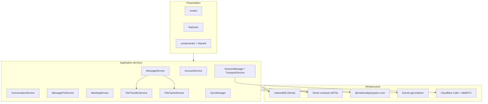

# Tóm tắt domain — `apps/chat`

**Nguồn sự thật:** chỉ `apps/chat/src/` (và dependency workspace được import từ đó). Mọi mô tả dưới đây bám theo code hiện tại, không dựa tài liệu khác trong repo.

Ứng dụng chat Web3 trên MetaNode: nhắn tin on-chain (1-1, nhóm, nhóm ẩn danh), file đính kèm, gọi thoại/video, meeting. Logic nghiệp vụ nằm chủ yếu ở `src/modules/`; UI theo feature ở `src/features/`; wiring dependency tại `src/container.ts` (composition root).

## Kiến trúc tổng quan

| Lớp                | Thư mục            | Vai trò                                                    |
| ------------------ | ------------------ | ---------------------------------------------------------- |
| Composition root   | `src/container.ts` | Khởi tạo singleton service, contract, sync strategy        |
| Domain modules     | `src/modules/*`    | Entity, service, repository, mapper, sync                  |
| Feature UI         | `src/features/*`   | Màn hình, hook React gắn với domain                        |
| Routing            | `src/routes/*`     | TanStack Router, guard đăng nhập                           |
| API / use-case mới | `src/new/*`        | Lớp gọi service/query gần UI (đang song song với `hooks/`) |
| Shared             | `src/shared/*`     | Hook dùng chung, React Query, i18n, layout                 |

---

## Domain chính

### 1. Wallet & Account (xác thực / danh tính local)

**Mục đích:** Quản lý ví native, đăng ký user on-chain, chọn tài khoản đang active, logout.

| Thành phần                             | Đường dẫn                |
| -------------------------------------- | ------------------------ |
| `WalletService`, `NativeWalletAdapter` | `src/modules/wallet/`    |
| `AccountService`, IndexedDB            | `src/modules/account/`   |
| UI đăng nhập / import ví               | `src/features/wallet/`   |
| Route                                  | `src/routes/wallets.tsx` |

**Luồng:** Chưa có account active → redirect `/wallets`. Sau khi active → `/_authenticated` load account và kiểm tra user bị disable qua `FactoryContract`.

**Phụ thuộc:** `FactoryContract`, `UserContract`, `@metanodejs/system-core` (hidden wallet, gửi lệnh chain).

---

### 2. Blockchain (hợp đồng on-chain)

**Mục đích:** Adapter gọi smart contract MetaNode cho user, nhóm, factory, file, verify/eKYC, meeting.

| Contract        | Thư mục                                            |
| --------------- | -------------------------------------------------- |
| Factory         | `src/modules/blockchain/factory-contract/`         |
| User            | `src/modules/blockchain/user-contract/`            |
| Group           | `src/modules/blockchain/group-contract/`           |
| Anonymous group | `src/modules/blockchain/anonymous-group-contract/` |
| File            | `src/modules/blockchain/file-contract/`            |
| Verify / eKYC   | `src/modules/blockchain/verify/`                   |
| Meeting         | `src/modules/blockchain/meeting-contract/`         |

**Gói liên quan:** `chat-react` (`contracts`), `@metanodejs/mtn-contract`, ABI JSON trong từng module.

Các service domain (conversation, message, account) không gọi chain trực tiếp từ UI mà qua các class contract này + `sendCommand` từ system-core.

---

### 3. Conversation (hội thoại)

**Mục đích:** Danh sách chat P2P / group / anonymous; tạo nhóm, thêm thành viên; đồng bộ metadata; mã hóa tin nhóm.

| Thành phần                           | Đường dẫn                                            |
| ------------------------------------ | ---------------------------------------------------- |
| `ConversationService`, types, mapper | `src/modules/conversation/`                          |
| Repository Dexie                     | `src/modules/conversation/infrastructure/indexeddb/` |
| `ConversationSyncStrategy`           | `src/modules/conversation/conversation.sync.ts`      |
| UI danh sách / tạo nhóm              | `src/features/conversation/`                         |
| Use-case mới                         | `src/new/conversation/`                              |

**Phụ thuộc:** User/Group/Factory/AnonymousGroup contracts, `FileCacheService`, `EventLogContainer`, Verify/eKYC (một số luồng nhóm).

**Route:** `/_authenticated/` (sidebar), `/_authenticated/$type.$id`, `detail.$type.$id`.

---

### 4. Message (tin nhắn)

**Mục đích:** Gửi/nhận/sửa/xóa tin; reply, reaction, sticker; đọc on-chain + optimistic UI; mã hóa nội dung.

| Thành phần                       | Đường dẫn                                           |
| -------------------------------- | --------------------------------------------------- |
| `MessageService`, entity, mapper | `src/modules/message/`                              |
| Worker xử lý file trong message  | `src/modules/message/workers/`                      |
| `MessagePinService`              | `src/modules/message-pin/`                          |
| UI thread chat                   | `src/features/message/`                             |
| Hook legacy                      | `src/hooks/mesage/`                                 |
| Use-case mới                     | `src/new/message/` (v4 send, list, mark-as-read, …) |
| Store Zustand                    | `src/stores/message.store.ts`                       |

**Phụ thuộc:** Conversation context, `FileContract`, `EventBus` (`AppEvents`), `asyncPriorityQueue` (`src/modules/realtime/`), event log.

**Hành vi đặc trưng:** Optimistic message, queue ưu tiên, đồng bộ qua event log và contract.

---

### 5. File (cache & transfer)

**Mục đích:** Cache blob/metadata cục bộ; upload/download chunk (worker); tích hợp `@metanodejs/file-module` và contract file.

| Thành phần                     | Đường dẫn                                                  |
| ------------------------------ | ---------------------------------------------------------- |
| `FileCacheService`             | `src/modules/file-cache/`                                  |
| `FileTransferService` + worker | `src/modules/file-transfer/`                               |
| Download pipeline mới          | `src/new/file/` (WebTransport, worker queue, …)            |
| UI chọn file / preview         | `features/message`, `components/message/content-variants/` |
| Store                          | `src/stores/file.store.ts`                                 |

**On-chain / package:** `FileContract` (`src/modules/blockchain/file-contract/`), `@metanodejs/file-module` (khai báo trong `package.json`, dùng tại các luồng file trong `src/`).

---

### 6. Sync (đồng bộ nền)

**Mục đích:** Đăng ký strategy đồng bộ định kỳ / nền sau khi đăng nhập.

| Thành phần                   | Đường dẫn                                                                |
| ---------------------------- | ------------------------------------------------------------------------ |
| `SyncManager`, `SyncFactory` | `src/modules/sync/`                                                      |
| Strategy đã đăng ký          | `ConversationSyncStrategy`, `AccountSyncStrategy` (trong `container.ts`) |
| Provider UI                  | `src/shared/background-sync/`                                            |

Invalidate React Query (ví dụ `CONVERSATIONS`) khi sync conversation xong.

---

### 7. Event & Event log

**Mục đích:** Bus nội bộ (`mitt`) và lắng nghe log on-chain / hệ thống để cập nhật UI và message.

| Thành phần                     | Đường dẫn                            |
| ------------------------------ | ------------------------------------ |
| `EventBusPort`, `MittEventBus` | `src/modules/event/`                 |
| `EventLogContainer`            | `src/modules/eventlogs/`             |
| React context                  | `src/contexts/event-log.context.tsx` |
| App event types                | `src/types/app-events`               |

Hook như `useMessageEvents`, `useGroupEvent`, `useRegisterEventLog` kết nối presentation với event log.

---

### 8. Call & Meeting (realtime)

**Mục đích:** Cuộc gọi 1-1 / nhóm, meeting room, raise hand, join request — kết hợp WebRTC và on-chain meeting.

| Thành phần                              | Đường dẫn                                                                                   |
| --------------------------------------- | ------------------------------------------------------------------------------------------- |
| `realtime-transport` (Cloudflare Calls) | `src/modules/realtime-transport/` (`realtime-transport.factory.ts`, `services/`, `config/`) |
| `MeetingService`, `MeetingContract`     | `src/modules/meeting/`, `blockchain/meeting-contract/`                                      |
| UI call                                 | `src/features/call/`                                                                        |
| Workspace                               | `@app/call`, `call-core`                                                                    |
| Route                                   | `src/routes/call.tsx`, `setup-meeting.tsx`                                                  |
| Hook sync call                          | `src/hooks/sync/use-sync-call.ts`                                                           |

`container.sessionManager` / `transportService` là entry point WebRTC; state call có thể đồng bộ với `call-core` (`getState`, `reset` trong `_authenticated` layout).

---

### 9. Settings & Notifications

**Mục đích:** Cài đặt app, thông báo trình duyệt / title tab.

| Thành phần         | Đường dẫn                                    |
| ------------------ | -------------------------------------------- |
| Settings UI        | `src/features/settings/`                     |
| Routes             | `/_authenticated/settings/`                  |
| Push noti helper   | `src/modules/noti/`                          |
| Title notification | `src/shared/hooks/use-title-notifiaction.ts` |

---

### 10. Modal & shell UI

**Mục đích:** Modal toàn cục (meeting URL, …), sidebar, navbar.

| Thành phần           | Đường dẫn                                                      |
| -------------------- | -------------------------------------------------------------- |
| Modal store          | `src/features/modal/`                                          |
| Layout authenticated | `src/routes/_authenticated.tsx`, `shared/components/partials/` |

---

## Routing (luồng người dùng)

| Route                        | Ý nghĩa                                    |
| ---------------------------- | ------------------------------------------ |
| `/wallets`                   | Onboarding ví                              |
| `/_authenticated`            | Shell: sync, event, sidebar, incoming call |
| `/_authenticated/$type.$id`  | Màn chat theo conversation                 |
| `/call`                      | Giao diện cuộc gọi                         |
| `/setup-meeting`             | Thiết lập meeting                          |
| `/_authenticated/settings/*` | Cài đặt                                    |

Guard: `beforeLoad` / `loader` trên `_authenticated` kiểm tra account active và trạng thái disabled.

---

## Phụ thuộc monorepo / bên ngoài

| Package                   | Vai trò trong chat                                          |
| ------------------------- | ----------------------------------------------------------- |
| `chat-react`              | Contract client, types dùng chung                           |
| `@metanodejs/system-core` | Ví, crypto, `sendCommand`, file buffer                      |
| `@metanodejs/event-log`   | Event log container                                         |
| `@metanodejs/file-module` | API file dùng chung với các luồng upload/download trong app |
| `@app/call` / `call-core` | State và UI call                                            |
| `@tanstack/react-query`   | Server/cache state cho list message, conversation           |
| `dexie`                   | Persistence local                                           |

---

## Cấu trúc source (đọc code)

| Khu vực            | Vai trò                                                                        |
| ------------------ | ------------------------------------------------------------------------------ |
| `src/modules/`     | Domain core: service + repository + factory + contract adapter                 |
| `src/container.ts` | Composition root — đăng ký dependency và sync strategy                         |
| `src/features/`    | UI theo feature + hook gọi service / query                                     |
| `src/new/`         | Use-case gần UI (message, conversation, file, status) — song song `src/hooks/` |
| `src/hooks/`       | Hook còn dùng từ layout và luồng cũ (message events, sync call, …)             |
| `src/components/`  | Component message/chat chưa gom hết vào `features/`                            |

Gửi tin: `handleSendMessage` (`src/new/message/send-message-v4.ts`) + optimistic `list-mesage` / `message-info`; `useSendMessage` là wrapper hook. `MessageService` dùng cho fetch/sync, không phải entry gửi từ UI chính.

---

## Điểm vào khi đọc code

1. `src/container.ts` — danh sách service và thứ tự khởi tạo.
2. `src/routes/_authenticated.tsx` — orchestration sau login (sync, events, call).
3. `src/modules/conversation/conversation.service.ts` / `src/modules/message/message.service.ts` — logic nghiệp vụ lớn nhất.
4. `src/features/conversation/` + `src/features/message/` — UI chat chính.
5. `src/modules/realtime-transport/` + `src/features/call/` — call/WebRTC.

_Cập nhật file này khi đổi cấu trúc `src/`, không khi đổi tài liệu phụ trong repo._
